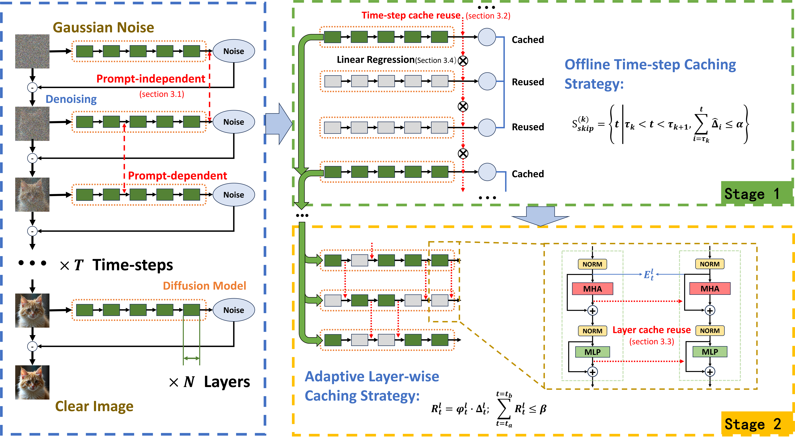

# MG-Cache: Multi-Granularity Caching for Accelerating Diffusion Transformer Inference

MG-Cache is a novel and fully training-free acceleration framework for Diffusion Transformer (DiT) inference. While DiTs have become a powerful backbone for high-quality image and video generation, their inference cost is dominated by the iterative denoising process and the quadratic growth of 3D self-attention, which makes high-resolution generation prohibitively expensive. Diffusion caching has emerged as a promising remedy, yet existing strategies fail to accurately identify the varying importance of different computational modules and rarely coordinate cache reuse across the timestep and layer granularities, making error accumulation difficult to control. To address these limitations, MG-Cache exploits computational redundancy at both granularities with a two-stage caching strategy: an offline timestep profiling analysis that identifies redundant timesteps whose computations can be safely skipped, followed by an adaptive layer-wise caching scheme that combines input stability with the importance of each Transformer layer to selectively cache stable Attention and MLP submodules. A lightweight linear regression compensation mechanism is further introduced to mitigate the distribution shift caused by cache reuse. Extensive experiments on mainstream open-source DiT models, such as HunyuanVideo and FLUX, validate the effectiveness of our approach, achieving significant acceleration while maintaining high fidelity to the uncached output, with up to a 4.18x speedup on HunyuanVideo.

**Paper:** [MG-Cache: Multi-Granularity Caching for Accelerating Diffusion Transformer Inference (Pacific Graphics 2026)](https://diglib.eg.org/items/fd588bbf-0ac6-4910-b075-280853d41adb)



*Overview of MG-Cache: a two-stage, multi-granularity caching framework that synergistically combines offline timestep profiling with online adaptive layer-wise caching to accelerate Diffusion Transformer inference.*

## Repository structure

The main directories and entry points are shown below.

```text
.
├── README.md                                             # Project overview and citation
├── MG-Cache.pdf                                          # Paper
├── MG-Cache/                                             # Our method
│   └── HunyuanVideo/                                     # MG-Cache on HunyuanVideo
│       ├── hyvideo/                                      # Model and inference implementation
│       │   ├── modules/                                  # Transformer blocks and caching logic
│       │   ├── diffusion/                                # Denoising pipeline and scheduler
│       │   ├── text_encoder/                             # Text encoders
│       │   ├── vae/                                      # Video VAE
│       │   ├── config.py                                 # Inference arguments
│       │   └── inference.py                              # Model loading and sampling
│       ├── calibration_data/                             # Precomputed calibration artifacts
│       │   ├── timestep_error.json
│       │   ├── layer_scores.pth
│       │   └── linear_fit_step.pth
│       ├── eval/                                         # VBench prompt lists
│       ├── scripts/                                      # FP8 and multi-GPU inference examples
│       ├── tests/                                        # Attention tests
│       ├── utils/                                        # Environment utilities
│       ├── sample_video.py                               # Single-prompt inference
│       ├── sample_video_vbench.py                        # VBench batch inference
│       ├── sample_vbench.sh                              # VBench launch script
│       ├── gradio_server.py                              # Web demo
│       └── requirements.txt                              # Python dependencies
├── baseline/                                             # Baseline implementations
│   ├── README.md                                         # Setup, paper settings, inference, and licenses
│   ├── FORA/                                             # FORA on HunyuanVideo
│   │   ├── hyvideo/                                      # Complete inference source with attention caching
│   │   └── sample_video.py                               # Single-prompt inference
│   ├── MixCache/                                         # MixCache on HunyuanVideo
│   │   ├── hyvideo/                                      # Complete inference source and MixCache controller
│   │   ├── configs/                                      # Cache configurations
│   │   ├── prompts/                                      # Profiling prompts
│   │   └── scripts/
│   │       ├── run_mixcache_batch.py                     # Batch inference
│   │       └── run_mixcache_profiling.py                 # Offline profiling
│   └── SmoothCache/                                      # SmoothCache on HunyuanVideo
│       ├── hyvideo/                                      # Complete inference source and SmoothCache runtime
│       ├── prompts/                                      # Calibration prompts
│       └── scripts/
│           ├── run_smoothcache_calibration.py            # Calibration
│           └── run_smoothcache_batch.py                  # Batch inference
└── fig/                                                  # Figures used in the README
```

Each baseline directory also contains its own requirements, tests, utilities, and
upstream license notices. See the [baseline guide](baseline/README.md) for setup
and inference commands.

## Baseline implementations

Complete HunyuanVideo inference source for our FORA, MixCache, and SmoothCache
baselines is available in [`baseline/`](baseline/README.md), with setup instructions,
inference examples, paper settings, and license information. The guide also links
to the official TeaCache and TaylorSeer implementations used in our experiments.

## Citation

If you find our work useful, please consider citing it:

```bibtex
@inproceedings{10.2312:pg.20261030,
  title     = {MG-Cache: Multi-Granularity Caching for Accelerating Diffusion Transformer Inference},
  author    = {Chen, Zesen and Xu, Youxuan and Li, Shigang},
  booktitle = {Pacific Graphics 2026 - Conference Papers and Posters},
  year      = {2026},
  publisher = {The Eurographics Association},
  ISBN      = {978-3-03868-327-8},
  DOI       = {https://doi.org/10.2312/pg.20261030}
}
```
